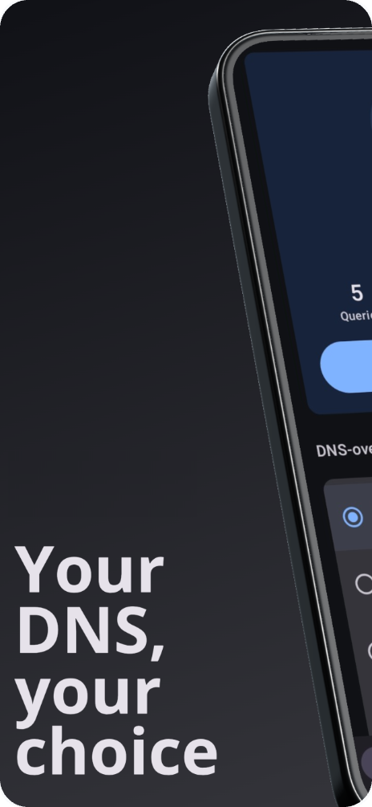
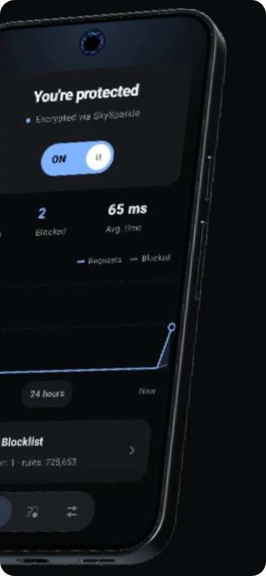
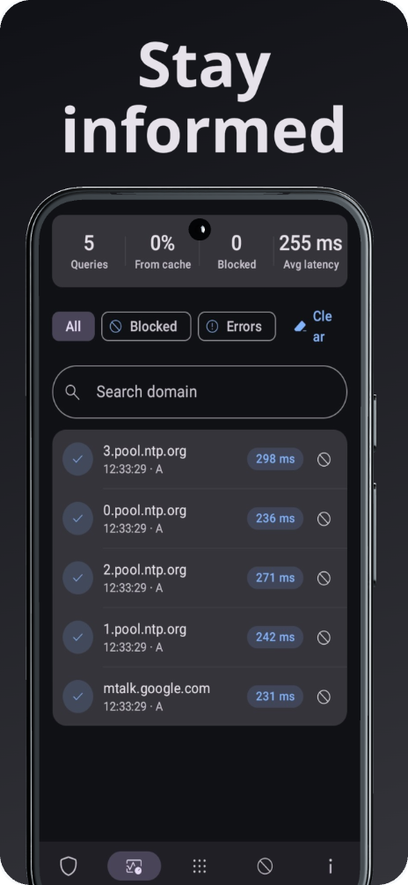
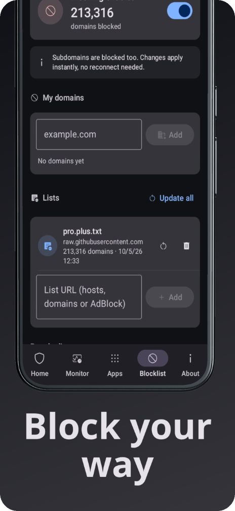
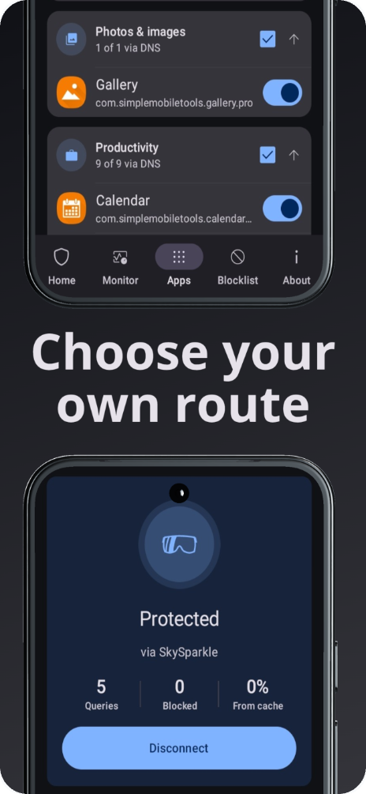
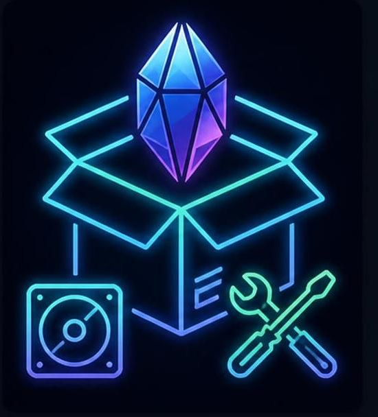

<p align="center">
  
</p>

<h1 align="center">SparkleDNS</h1>

<p align="center">
  <b>A lightweight DNS-over-HTTPS client for Android.</b><br>
  A local VPN that captures only DNS traffic and sends every query to the DoH server you choose (RFC 8484). Everything else goes through your normal connection.
</p>

<p align="center">
  <a href="https://github.com/kalarina-bit/Sparkledns/releases/latest"></a>
</p>

<p align="center">
  <a href="https://f-droid.org/packages/cc.skysparkle.sparkledns/"></a>
  <a href="https://apps.obtainium.imranr.dev/redirect?r=obtainium://add/https://git.skysparkle.cc/kalarina/Sparkledns"></a>
  <a href="https://github.com/kalarina-bit/Sparkledns/releases/latest"></a>
  <a href="https://git.skysparkle.cc/kalarina/Sparkledns/releases"></a>
</p>

<p align="center">
  
  
  
  
  
</p>

## ✨ Features

- 🔌 **One-tap connect/disconnect**, with a Quick Settings tile
- 🔄 **Switch servers on the fly** — the tunnel restarts automatically
- 🚀 **Built-in server test** showing protocol and latency
- 📊 **Live query monitor** with stats, filters and one-tap blocking
- 📱 **Per-app DNS** — chosen apps bypass the tunnel
- 🚫 **Custom blocklists** — your own domains plus hosts/domain/AdBlock lists by URL (HaGeZi Pro++ and TIF presets)
- 🔓 **No analytics, no Google Play Services**

##  Installation

- **[F-Droid](https://f-droid.org/packages/cc.skysparkle.sparkledns/)** — install and update through the F-Droid client.
- **[Obtainium](https://apps.obtainium.imranr.dev/redirect?r=obtainium://add/https://git.skysparkle.cc/kalarina/Sparkledns)** — installs the APK straight from Gitea releases and keeps it up to date.
- **Manually** — download the latest APK from [GitHub](https://github.com/kalarina-bit/Sparkledns/releases/latest) or [Gitea](https://git.skysparkle.cc/kalarina/Sparkledns/releases), allow installs from unknown sources for the app you open it with (Settings → Apps → Special access → Install unknown apps), then open the `.apk` and confirm.

##  Verifying a download

Every official APK is signed with the same key. Check it before installing:

```sh
apksigner verify --print-certs SparkleDNS-v<version>.apk
```

The SHA-256 fingerprint of the signing certificate must be:

```
42:F6:30:63:4B:D0:F8:7F:49:17:85:A8:84:87:70:E4:45:96:7B:36:F1:02:8E:FD:16:F8:F9:52:01:27:3A:29
```

`apksigner` prints the same value in lowercase without colons. On Android you can check it with [AppVerifier](https://github.com/soupslurpr/AppVerifier) (app ID `cc.skysparkle.sparkledns`).

##  Building from source

Requires JDK 17+ and Android SDK 36.

```sh
./gradlew assembleRelease
```

### Releasing

1. Bump `versionName` and `versionCode` in `app/build.gradle.kts` (`versionCode = major * 10000 + minor * 100 + patch`).
2. Add `fastlane/metadata/android/<locale>/changelogs/<versionCode>.txt`.
3. Tag the commit as `v<versionName>` (for example `v1.0.9`) — F-Droid detects new releases from these tags, so upload the signed APK to the release right away.

## 🤝 Contributing

Bug reports, DoH server and blocklist suggestions, translation fixes and pull requests are welcome in the [issue tracker](https://git.skysparkle.cc/kalarina/Sparkledns/issues). Please read [CONTRIBUTING.md](CONTRIBUTING.md) first — it explains what fits the project and how to send changes. To open an issue or a pull request, [create an account](https://git.skysparkle.cc/user/sign_up) on this Gitea.

## 📄 License

[GNU General Public License v3.0 or later](LICENSE).
