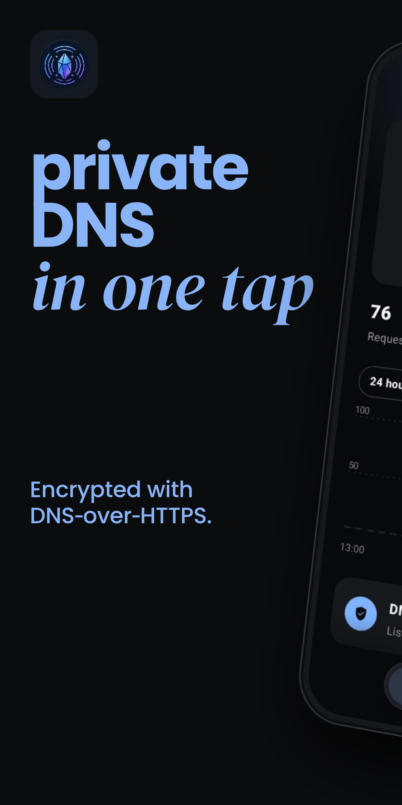
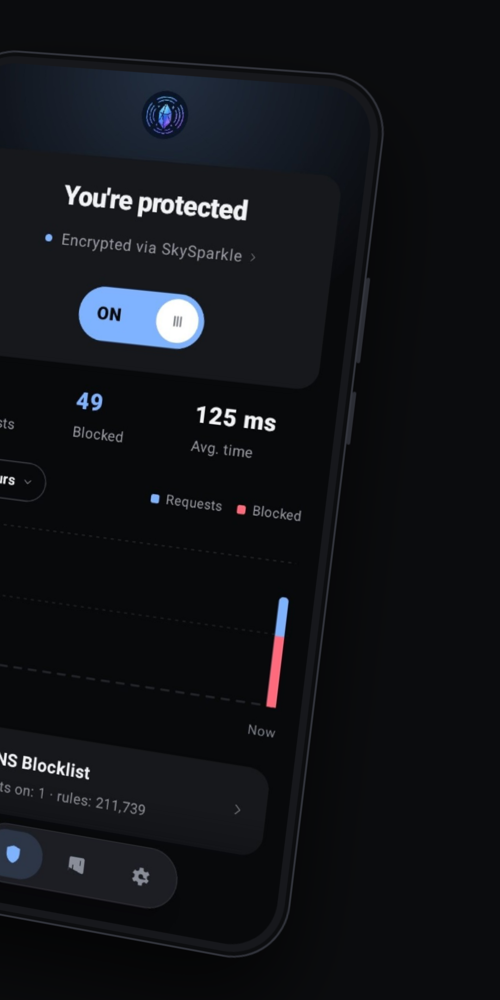
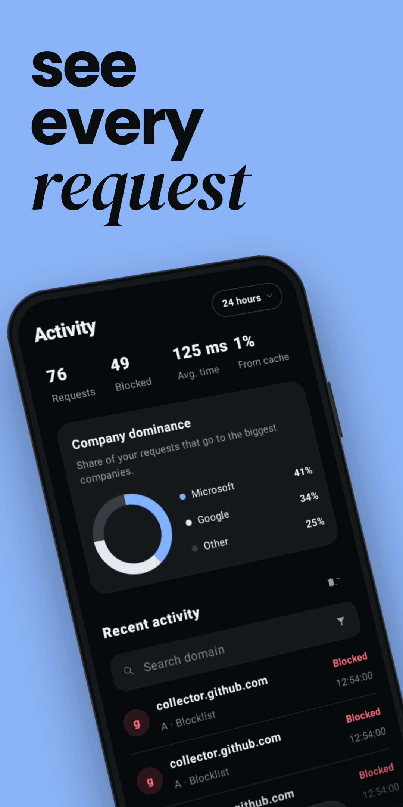
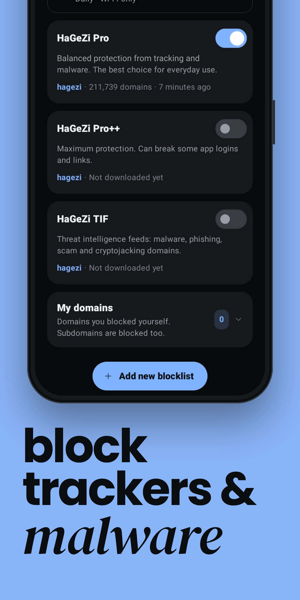

<p align="center">
  
</p>

<h1 align="center">SparkleDNS: Private DNS &amp; DoH</h1>

<p align="center">
  <b>Encrypted DNS over HTTPS, tracker blocklists, live query log and per-app rules</b><br>
  <sub>Only DNS goes through the app — the rest of your traffic stays on your normal connection.</sub>
</p>

<p align="center">
  <a href="https://github.com/kalarina-bit/Sparkledns/releases/latest"></a>
  <a href="https://f-droid.org/packages/cc.skysparkle.sparkledns/"></a>
  <a href="LICENSE"></a>
</p>

<p align="center">
  <a href="https://play.google.com/store/apps/details?id=cc.skysparkle.sparkledns"></a>
  <a href="https://f-droid.org/packages/cc.skysparkle.sparkledns/"></a>
  <a href="https://apps.obtainium.imranr.dev/redirect?r=obtainium://add/https://github.com/kalarina-bit/Sparkledns"></a>
  <a href="https://github.com/kalarina-bit/Sparkledns/releases/latest"></a>
</p>

<p align="center">
  
  
  
</p>

## Features

- **Encrypted DNS in one tap** — DoH (RFC 8484) to the server you choose, from the app or a Quick Settings tile. No root.
- **Server test** — protocol and latency of each server; switch while connected.
- **Blocklists** — your own domains plus hosts/domain/AdBlock lists by URL (HaGeZi Pro, Pro++, TIF), auto-updated, Wi-Fi only if you like.
- **Live query log** — filters, one-tap blocking, 24-hour and 7-day charts. Stays on your device.
- **Per-app DNS** — chosen apps bypass the tunnel.
- **Private by design** — no analytics, no ads, no Google Play Services.

## How it works

SparkleDNS uses Android's VPN interface to create a **local** tunnel that captures DNS traffic only. It is not a VPN service: there is no remote server and your IP address does not change.

## Verify the APK

Every official APK is signed with the same key:

```sh
apksigner verify --print-certs SparkleDNS-v<version>.apk
```

```
42:F6:30:63:4B:D0:F8:7F:49:17:85:A8:84:87:70:E4:45:96:7B:36:F1:02:8E:FD:16:F8:F9:52:01:27:3A:29
```

On Android, use [AppVerifier](https://github.com/soupslurpr/AppVerifier) with app ID `cc.skysparkle.sparkledns`.

## Build

JDK 17+ and Android SDK 36:

```sh
./gradlew assembleRelease
```

<details>
<summary>Releasing</summary>

1. Bump `versionName` and `versionCode` in `app/build.gradle.kts` (`versionCode = major * 10000 + minor * 100 + patch`).
2. Add `fastlane/metadata/android/<locale>/changelogs/<versionCode>.txt`.
3. Tag the commit as `v<versionName>` (e.g. `v1.0.9`) and upload the signed APK to the release right away — F-Droid picks up new tags.

</details>

## Contributing

Bug reports, server and blocklist suggestions, translations and pull requests are welcome in the [issue tracker](https://github.com/kalarina-bit/Sparkledns/issues). Please read [CONTRIBUTING.md](CONTRIBUTING.md) first.

## Sponsor

<a href="https://skysparkle.cc"></a> Sponsored by **[Skysparkle](https://skysparkle.cc)** — independent encrypted DNS from Lithuania and the app's default server. Help keep the servers running on [Ko-fi](https://ko-fi.com/skysparkle).

## License

[GPL-3.0-only](LICENSE)
